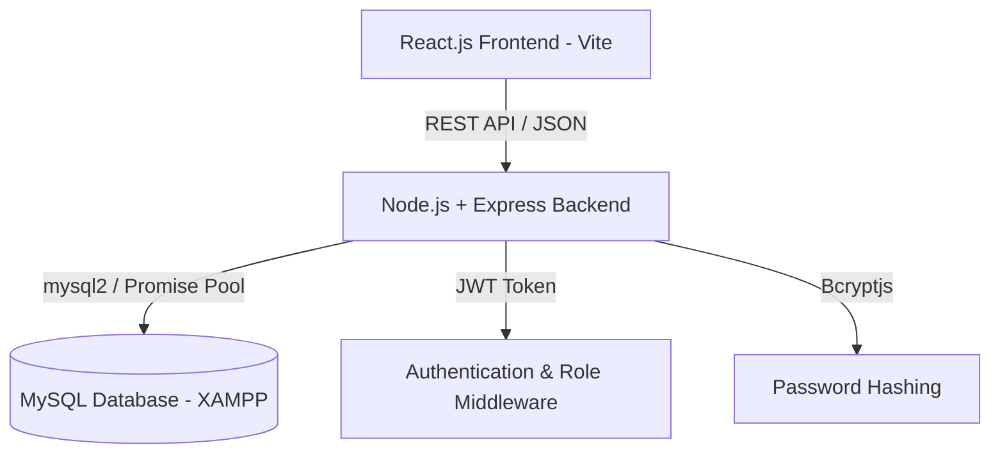

# Full-Stack Online Bus Booking System

A complete, production-grade Online Bus Ticket Booking System built from scratch using **React.js**, **Bootstrap 5**, **Node.js**, **Express.js**, **MySQL / MariaDB (XAMPP)**, and **JWT Authentication**.

---

## 🌟 Key Features

### Passenger / User Features
- **User Authentication**: Secure registration, login, JWT token authorization, profile updates, and password changes.
- **Dynamic Bus Search**: Search buses by Source, Destination, and Travel Date (e.g. Ahmedabad → Mumbai).
- **Advanced Filtering & Sorting**: Filter buses by AC / Non-AC, Sleeper / Seater, price range, bus operator, and passenger rating. Sort by price, departure time, rating, and duration.
- **Interactive Seat Selection Layout**: Real-time visual seat layout showing Available (Green), Selected, and Booked (Disabled) seats with live price calculation.
- **Backend Seat Locking**: Double-checks seat availability with database row locks (`FOR UPDATE`) to prevent double-booking.
- **Simulated Payment Gateway**: Complete simulated checkout supporting UPI, Credit Card, Debit Card, and Net Banking.
- **Instant Digital Ticket Generation**: Generates unique Booking Reference (e.g., `BUS202610041234`), QR code, passenger breakdown, printable ticket PDF format.
- **Booking Management & Cancellation**: View active/past bookings, download digital tickets, and perform 1-click cancellations with simulated refunds.
- **Ratings & Reviews**: Passenger review system restricted to users with verified completed trips.

### Administrator Features
- **Protected Admin Dashboard**: Overview metrics for Total Users, Active Buses, Total Routes, Total Bookings, Revenue, and monthly booking trends.
- **Bus Fleet Management**: Full CRUD operations to add, edit, and remove buses (Volvo AC, AC Sleeper, Seater, etc.) with automatic seat generation.
- **Route Management**: Add and manage travel routes with distance calculation and validation against duplicate cities.
- **Schedule Management**: Create and manage bus schedules with travel dates, departure/arrival times, and fare prices.
- **Booking & Revenue Oversight**: View all customer reservations, filter by booking status, inspect passenger manifests, and manage cancellations.
- **User Account Control**: Manage registered accounts with activate/deactivate toggles.

---

## 🏗️ Project Architecture



### Folder Structure
```
bus-booking-system/
│
├── frontend/                     # React.js SPA (Vite + Bootstrap 5)
│   ├── src/
│   │   ├── components/          # Navbar, Footer, BusCard, SearchForm, SeatLayout, etc.
│   │   ├── pages/               # Home, SearchResults, BusDetails, SeatSelection, Payment, etc.
│   │   │   └── admin/           # AdminDashboard, ManageBuses, ManageRoutes, etc.
│   │   ├── context/             # AuthContext, BookingContext
│   │   ├── services/            # Axios API Service wrapper
│   │   ├── App.jsx              # Routes & Protected Routing
│   │   └── main.jsx
│   ├── package.json
│   └── vite.config.js
│
├── backend/                      # Express.js REST API Server
│   ├── config/                  # Database pool config (db.js)
│   ├── controllers/             # Auth, Bus, Route, Schedule, Booking, Payment, Admin controllers
│   ├── middleware/              # JWT Auth, Admin Role, Error Handlers
│   ├── routes/                  # RESTful API Route definitions
│   ├── server.js                # Entry point
│   ├── seed.js                  # Database seeder
│   └── package.json
│
├── database/
│   └── bus_booking_db.sql        # MySQL database schema & sample data
│
├── postman_collection.json       # Ready-to-import Postman API collection
├── README.md                     # Documentation
└── .gitignore
```

---

## 🛠️ Required Technology Stack

- **Frontend**: React.js (v18), JavaScript (ES6+), HTML5, CSS3, Bootstrap 5, Lucide Icons, React Router v6, Axios.
- **Backend**: Node.js, Express.js, JWT (`jsonwebtoken`), Password Hashing (`bcryptjs`), CORS, Dotenv.
- **Database**: MySQL / MariaDB (provided via XAMPP).
- **Tools**: VS Code, XAMPP, Postman, Git.

---

## 🔑 Demo Account Credentials

| Role | Email | Password | Access Level |
|---|---|---|---|
| **Demo User** | `user@example.com` | `user123` | Passenger Booking & Profile |
| **Demo Admin** | `admin@busbooking.com` | `admin123` | Admin Dashboard & Fleet Control |

---

## 🚀 Step-by-Step Setup & Running Instructions

### 1. Database Setup (XAMPP)
1. Open **XAMPP Control Panel** and start **MySQL** (Port `3306`).
2. Open phpMyAdmin in your browser: [http://localhost/phpmyadmin](http://localhost/phpmyadmin)
3. Create a new database named `bus_booking_db` (or run the provided script).
4. Import the file `database/bus_booking_db.sql`:
   ```bash
   # Or via CLI / PowerShell:
   Get-Content database/bus_booking_db.sql -Raw | C:\xampp\mysql\bin\mysql.exe -u root
   ```

### 2. Backend Setup & Startup
```bash
cd backend
npm install
npm run dev
```
- Server will listen at: **`http://localhost:5000`**
- Health Check: **`http://localhost:5000/api/health`**

### 3. Frontend Setup & Startup
```bash
cd frontend
npm install
npm run dev
```
- Open browser at: **`http://localhost:5173`**

---

## 📡 Key REST API Endpoints

### Authentication
- `POST /api/auth/register` - Register a new passenger
- `POST /api/auth/login` - Authenticate user or admin
- `GET /api/auth/profile` - Get logged-in user profile & stats (Protected)

### Search & Schedules
- `GET /api/search?from=Ahmedabad&to=Mumbai&date=2026-10-15` - Search matching buses
- `GET /api/schedules/:id/seats` - Fetch real-time seat availability layout

### Bookings & Payments
- `POST /api/bookings` - Create booking (atomic seat verification & transaction)
- `GET /api/bookings` - List user's bookings
- `PUT /api/bookings/:id/cancel` - Cancel booking and issue simulated refund

### Admin Control
- `GET /api/admin/dashboard` - Get system statistics and metrics
- `POST /api/buses` - Add new bus to fleet (Protected Admin)
- `POST /api/schedules` - Create new schedule (Protected Admin)

---

## 🧪 Testing with Postman

Import the `postman_collection.json` file into Postman. It includes pre-configured sample requests for:
- User Register & Login
- Admin Login
- Bus & Route CRUD
- Schedule Search & Seats
- Booking Creation & Cancellation
- Admin Dashboard Statistics

---

## 🛡️ Security & Quality Standards
- Passwords are strictly hashed with `bcryptjs` (salt rounds: 10).
- JWT Tokens are verified on all protected API routes.
- SQL Injection protection via parameterized `mysql2` queries.
- Database transactions ensure partial bookings or seat collisions never occur.

---

## 📜 License
This project is open-source and built for academic and portfolio demonstration purposes.
